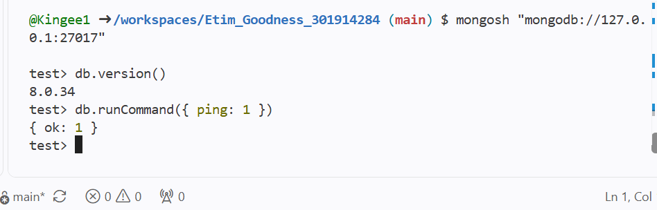

# MongoDB setup

MongoDB Community Server 8.0.34 runs in the existing Ubuntu 24.04 Codespace alongside PostgreSQL for the Bank / Fintech Platform case study. The mongosh client version installed is 2.14.0.

The database files are stored in /workspaces/mongodb-data, outside the Git repository. MongoDB listens on 127.0.0.1. This local practice setup uses fictional data and has no database authentication.

## Start and connect

Check whether MongoDB is already running before starting it:

```bash
pgrep -a mongod
```

If no MongoDB process is listed, start it:

```bash
mongod --dbpath /workspaces/mongodb-data --logpath /workspaces/mongodb-data/mongod.log --logappend --bind_ip 127.0.0.1 --fork
```

Connect using:

```bash
mongosh "mongodb://127.0.0.1:27017"
```

Port 27017 must not be forwarded. If it appears in the Codespaces Ports tab, stop forwarding it.

## Connection check

In mongosh, db.version() returns 8.0.34 and db.runCommand({ ping: 1 }) returns { ok: 1 }. These checks confirm the connection; no fintech documents are inserted in this step.



## Installation

The official MongoDB 8.0 Ubuntu Noble repository is recorded in [MongoDBSource.list](Etim_Goodness_301914284_P4_MongoDBSource.list).

The installation uses these commands in the Codespaces shell:

```bash
sudo apt-get update
sudo apt-get install -y gnupg curl
curl -fsSL --connect-timeout 10 --max-time 30 https://pgp.mongodb.com/server-8.0.asc -o /tmp/mongodb-server-8.0.asc
sudo gpg --dearmor --yes --output /usr/share/keyrings/mongodb-server-8.0.gpg /tmp/mongodb-server-8.0.asc
sudo install -m 644 portfolio-4-nosql/Etim_Goodness_301914284_P4_MongoDBSource.list /etc/apt/sources.list.d/mongodb-org-8.0.list
sudo apt-get update
sudo apt-get install -y mongodb-org-server mongodb-mongosh
mkdir -p /workspaces/mongodb-data
```

The server starts directly because systemd is unavailable in this Codespace. Installation and source-file setup do not need repeating while the installed setup remains available.

## Reference

[MongoDB 8.0 — Ubuntu installation guide](https://www.mongodb.com/docs/v8.0/tutorial/install-mongodb-on-ubuntu/)